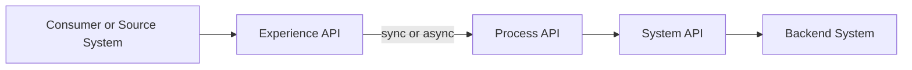
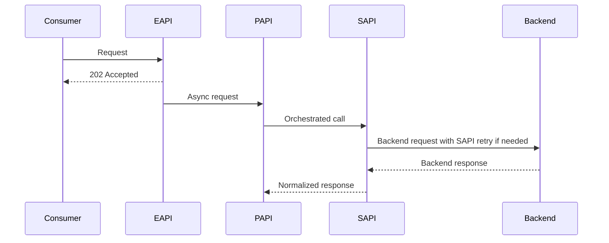

# Mule Integration Architecture Output Format

Use this format unless the provided files contain a stricter user-story template.

## Architecture Package

### Inputs Reviewed

List each input and what was extracted:
- Requirement text, PDF, screenshot, OAS file, schema, mapping, existing project, or ruleset.

### Existing Capability Scan

| Candidate | Layer | Evidence | Fit | Decision |
|---|---|---|---|---|
| `<project>` | EAPI/PAPI/SAPI | `<file/path and endpoint/schema/flow>` | Good/partial/no fit | Reuse/extend/create |

### Recommended Integration Shape

Describe the flow in layer order:
1. Consumer -> EAPI: endpoint, auth, request/response status.
2. EAPI -> PAPI: sync or async handoff. For 202, default async handoff is EAPI to PAPI.
3. PAPI orchestration: business decisions, parallel/serial calls, callback or rollback behavior.
4. PAPI -> SAPI or EAPI -> SAPI, when no PAPI is needed: backend calls.
5. SAPI -> backend: backend-specific mapping, auth, retry, timeout, and error handling.

### Mermaid Diagrams

Always include a layer diagram for non-trivial integration analysis:



Use a sequence diagram when timing, async handoff, callback, retry, rollback, or error handling matters:



Diagram rules:
- Use real project/API names when known.
- Label edges with method/path or event name when known.
- Mark unknown target systems as `TBD` and add a stakeholder question.
- Keep diagrams as Markdown Mermaid blocks; do not create PNG/SVG files unless requested.

### Architecture Decisions

For each decision:
- Decision:
- Rationale:
- Evidence:
- Assumptions:
- Risks:

### Stakeholder Questions

Group questions by topic:
- Business process and ownership
- API contract and status codes
- Data mapping and validation
- Error handling and retry
- Async/callback behavior
- Environments, credentials, and deployment
- Testing and acceptance

Prefer questions that block implementation. Avoid generic questions when local evidence already answers them.

## Internal User Story Format

Use IDs like `INT-001`, `INT-002`, ordered by dependency.

```markdown
### INT-001 - <short title>

Type: Contract | Config | Flow | Mapping | Test | Deployment | Validation
Layer: EAPI | PAPI | SAPI | Cross-layer
Project: <project-name or new>
Decision: Reuse | Extend | Create
Priority: P0 | P1 | P2
Status: Proposed | Blocked | Ready | In Progress | Done

Description:
<business and technical intent in 2-4 sentences>

As a <consumer/system/team>,
I want <capability>,
so that <outcome>.

Scope:
- <included change>
- <included change>

Out of Scope:
- <explicitly excluded change>

Acceptance Criteria:
- Given <context>, when <action>, then <observable result>.
- Given <context>, when <failure>, then <error/status/log/callback behavior>.

Implementation Notes:
- Files likely touched:
- Existing API/project evidence:
- Required config keys:
- Required DWL/schema/test fixtures:
- Retry/async rule:

Dependencies:
- <story id or stakeholder answer>

Open Questions:
- <question or none>

Developer Handoff:
- Target agent: mule-analyzer | mule-implementer | mule-bugfixer (new project: mule-new-project skill)
- Handoff input: <ruleset/project/story summary>
```

## Implementation Plan

Create a short execution plan:
1. Architecture approval or blocker answers.
2. User story execution order.
3. Per-story developer pipeline.
4. Validation and deployment gates.
5. Remaining risks.

## Developer Execution Handoff

When the user asks to execute, pass only one story into the developer pipeline at a time:

```text
Selected story: <INT-ID and title>
Target project(s): <project list>
Layer decision: <EAPI/PAPI/SAPI>
Files/evidence: <paths>
Scope: <exact implementation scope>
Acceptance criteria: <copy from story>
Open blockers: <none or list>
```
